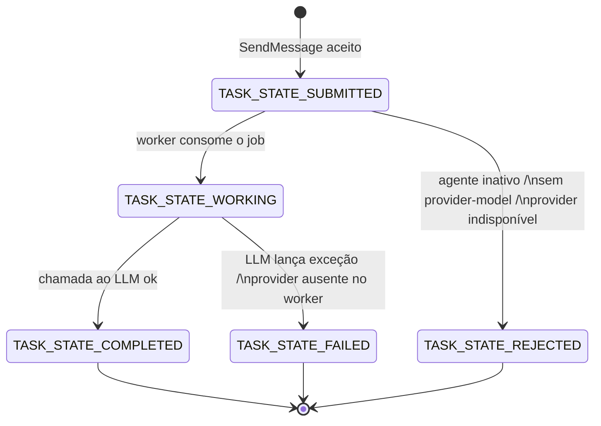
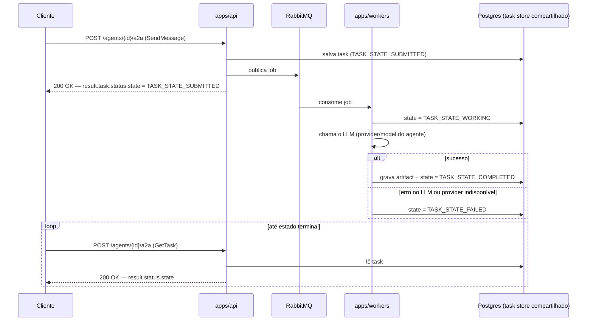

# Integração via A2A — guia para desenvolvedores

Este documento descreve como enviar mensagens para um agente cadastrado no
Buteco Agents e acompanhar o processamento até o resultado final, usando o
endpoint A2A exposto por `apps/api`.

**Pré-requisito**: você já precisa ter o `id` (GUID) de um agente cadastrado
e ativo — o cadastro/gestão de agentes (`POST /agents`, `GET /providers`,
ativar/desativar) não é coberto aqui. E `SendMessage`/`GetTask` exigem
`Authorization: Bearer <token>`, o access token do emissor do Buteco para uma
**aplicação externa** — ver [Autenticação](#autenticação), que diz como obtê-lo
e quais agentes e operações ele alcança.

## Índice

- [O endpoint](#o-endpoint)
- [Descoberta do agente via AgentCard](#descoberta-do-agente-via-agentcard)
- [A regra mais importante: erro não é HTTP 4xx/5xx](#a-regra-mais-importante-erro-não-é-http-4xx5xx)
- [Método `SendMessage`](#método-sendmessage)
- [Push Notification (Webhook)](#push-notification-webhook)
- [Método `GetTask`](#método-gettask)
- [Onde está a resposta do agente](#onde-está-a-resposta-do-agente)
- [Enumeradores](#enumeradores)
- [Estados da Task e como tratar cada um](#estados-da-task-e-como-tratar-cada-um)
- [Diagramas de fluxo](#diagramas-de-fluxo)
- [Erros do protocolo](#erros-do-protocolo)
- [Recomendações de polling](#recomendações-de-polling)
- [Notas operacionais](#notas-operacionais)

## O endpoint

```
POST /agents/{id}/a2a
Content-Type: application/json
Authorization: Bearer <token>
```

- `{id}` é o GUID do agente, atribuído no cadastro (`POST /agents`).
- Em desenvolvimento local, a porta padrão é `5017` (ver
  `apps/api/src/Buteco.Api/Properties/launchSettings.json`) — em outros
  ambientes, confirme a porta/host configurados.
- O corpo é sempre um envelope [JSON-RPC 2.0](https://www.jsonrpc.org/specification):

```json
{
  "jsonrpc": "2.0",
  "id": 1,
  "method": "SendMessage",
  "params": { }
}
```

Este endpoint implementa o protocolo [A2A](https://a2a-protocol.org/latest/)
na íntegra (é a SDK oficial `A2A.AspNetCore` quem expõe a rota), mas o
Buteco Agents só dá suporte real a dois métodos: **`SendMessage`** e
**`GetTask`** — mais o registro de push notification (webhook), que não é
um método à parte: é um campo opcional dentro do próprio `SendMessage` (ver
[Push Notification (Webhook)](#push-notification-webhook)). Outros métodos
do protocolo (streaming, listar tasks, os métodos JSON-RPC dedicados de
gestão de push notification config — `CreateTaskPushNotificationConfig` e
afins —, **`GetExtendedAgentCard`**) não fazem parte do contrato suportado —
não use; para a aplicação externa eles respondem `403` (ver
[O que a aplicação alcança](#o-que-a-aplicação-alcança)). Para descobrir
metadados do agente, use o endpoint HTTP dedicado abaixo, não
`GetExtendedAgentCard` via JSON-RPC.

**Cancelamento (`CancelTask`), como é hoje:** a rota o atende para o token de
serviço do Buteco, e ele grava `TASK_STATE_CANCELED` na task. Mas o
`apps/workers` não interrompe uma task que já está em `TASK_STATE_WORKING`: ele a
termina e grava `TASK_STATE_COMPLETED` ou `TASK_STATE_FAILED` por cima do
`canceled`. Só a task que o worker ainda não pegou fica cancelada de verdade.
Para a aplicação externa, `CancelTask` responde `403` (não é operação
liberável). O cancelamento real está na
[#264](https://github.com/aldovrando-oliveira/buteco-agentes/issues/264).

### Autenticação

A rota `POST /agents/{id}/a2a` exige `Authorization: Bearer <token>`. Sem
token válido, a resposta é **HTTP `401`, com corpo vazio**, antes de o
JSON-RPC ser processado — a única exceção à regra de
[erro não ser HTTP 4xx/5xx](#a-regra-mais-importante-erro-não-é-http-4xx5xx).
Com token válido de quem não pode chamar a rota, a resposta é **`403`, com
corpo vazio**, também antes do JSON-RPC.

O [AgentCard](#descoberta-do-agente-via-agentcard) é público e declara, em
`securitySchemes`, o esquema OAuth2 do Buteco: fluxo `clientCredentials`, o
endpoint de token e o escopo `buteco-api`. As outras rotas anônimas de
`apps/api` são as sondas de saúde e as do próprio emissor (discovery, JWKS,
`/connect/*` e as de sessão do painel); não há `POST /auth/login`, que saiu na
#217.

#### A credencial: aplicação externa

Um **Admin** do painel cadastra a aplicação em **Aplicações externas** (rotas
`/applications/*` do `apps/api`). O Buteco gera:

- o **client ID**, no formato `btc_app_` + 8 caracteres, que não muda;
- um **segredo**, `btc_sk_` + 43 caracteres, **mostrado uma vez**: o Buteco
  guarda só o hash e não consegue mostrá-lo de novo. Se ele se perder, o Admin
  gera outro.

Cada segredo vale **1 ano**. Gerar um segredo novo deixa os anteriores valendo
por mais **7 dias**, para a aplicação trocar sem parar; há no máximo **3
segredos vivos** por aplicação. Revogar um segredo, ou desativar a aplicação,
recusa o próximo pedido de token na hora.

#### O token

```bash
curl -X POST https://[URL_PUBLICA]/connect/token \
  -d grant_type=client_credentials \
  -d client_id=btc_app_7kq2m9x4 \
  -d client_secret=$CLIENT_SECRET \
  -d scope=buteco-api
```

A resposta traz `access_token` e `expires_in` = `300`: **o token da aplicação
dura 5 minutos**. Peça outro quando ele vencer; não há refresh token.

- **Mande sempre `scope=buteco-api`.** Sem `scope`, o emissor emite um token
  sem audiência, e o `apps/api` o recusa com `401` em toda rota.
- Outro escopo (`buteco-inbox`, `buteco-connectors`) é recusado no pedido, com
  `invalid_request`: a aplicação só chama o `apps/api`.
- Segredo errado, revogado ou vencido, e aplicação desativada: `invalid_client`.
- **Revogar não corta o token já emitido.** Ele é validado pela assinatura,
  sem consulta ao banco, e continua aceito até vencer — **no máximo 5 minutos**
  depois da revogação ou da desativação.

#### O que a aplicação alcança

**Só os agentes liberados para ela, e em cada um só as operações liberadas.**
A aplicação nasce sem nenhum agente. O Admin libera agentes para ela, com as
operações de cada agente, pelas rotas `/applications/{id}/agents` (a tela em
**Aplicações externas** é da #188; até lá, o roteiro pela API está em
[deployment.md](deployment.md#agentes-liberados-por-aplicação-externa-187)):

| operação | o que libera |
| --- | --- |
| Enviar mensagem | `SendMessage` (criar task, continuar a conversa ou a task) |
| Consultar task | `GetTask` |
| Notificação push | `configuration.pushNotificationConfig` dentro do `SendMessage` |

A rota `POST /agents/{id}/a2a` é a única do `apps/api` que o token da aplicação
alcança; em toda outra, a resposta é `403`. Na rota A2A, **antes** do JSON-RPC:

- **`404`, corpo vazio**: o agente não está liberado para a aplicação, ou não
  existe, ou a aplicação foi desativada. A resposta é a mesma nos três casos,
  e não diz se o agente existe. A desativação vale **na hora** para esta rota,
  mesmo com um token ainda no prazo de 5 minutos;
- **`403`, corpo vazio**: o método não está entre as operações liberadas para a
  aplicação naquele agente. Inclui `SendMessage` com `pushNotificationConfig`
  sem a operação de push (a chamada inteira é recusada, sem criar task), e todo
  método fora das três operações: `CancelTask`, `ListTasks`, os de streaming, os
  de push config e `GetExtendedAgentCard`.

Passando, o JSON-RPC segue como no resto deste guia, com três regras a mais:

- **Cada aplicação só vê as próprias tasks**, e só pela rota do agente em que
  ela foi criada. O `GetTask`, ou o `SendMessage` com `message.taskId`, de uma
  task de outra aplicação, de uma task do próprio Buteco ou de uma task dela em
  outro agente responde o mesmo erro de task inexistente (`-32001`).
- **O `contextId` só vale se for de uma conversa da aplicação naquele agente.**
  Um `contextId` que não existe e um de outra conversa recebem o mesmo erro,
  `-32602` "Contexto não encontrado.", sem criar task. Para abrir uma conversa
  nova, **omita** o `contextId`: o Buteco gera um e o devolve na task.
- **A notificação push** registrada com a operação liberada é entregue quando a
  task termina, mesmo que o Admin retire a operação ou o agente depois. A
  retirada vale para as chamadas seguintes.

Um agente liberado e **inativo** continua liberado: o `SendMessage` termina
`TASK_STATE_REJECTED`, como para qualquer chamador. A delegação entre agentes
não depende do que a aplicação tem liberado: o agente dela pode delegar para
outro agente, e a resposta chega na task dela; a task do agente delegado não é
alcançável pela aplicação.

O token do painel recebe `403` nesta rota, com qualquer papel (#184): ela é de
serviço e de aplicação, não do painel.

## Descoberta do agente via AgentCard

```
GET /agents/{id}/.well-known/agent-card.json
```

Retorna o [`AgentCard`](https://a2a-protocol.org/latest/) do agente — nome,
descrição, skills e capacidades — para um cliente A2A decidir se/como
invocar o agente **antes** de enviar a primeira mensagem. Sempre `200 OK`
com o card se `{id}` corresponde a um agente cadastrado, **mesmo que o
agente esteja inativo ou sem `provider`/`model` configurados** — descoberta
de metadado é independente de garantia de execução (o `SendMessage` para um
agente nesse estado ainda seria rejeitado, ver
[Estados da Task](#estados-da-task-e-como-tratar-cada-um)). Só `404` quando
`{id}` não corresponde a nenhum agente.

O card reflete o estado atual do agente a cada requisição — sem cache. Uma
edição via `PUT /agents/{id}` (nome, descrição, skills) aparece na próxima
consulta ao card, sem exigir reinício de nada.

### Exemplo de resposta

```bash
curl http://localhost:5017/agents/<agentId>/.well-known/agent-card.json
```

```json
{
  "name": "Atendente de Suporte",
  "description": "Responde dúvidas de clientes.",
  "version": "1.0.0",
  "supportedInterfaces": [
    { "url": "http://localhost:5017/agents/<agentId>/a2a", "protocolBinding": "JSONRPC", "protocolVersion": "1.0" }
  ],
  "capabilities": { "streaming": false, "pushNotifications": true },
  "skills": [
    { "id": "consulta-cep", "name": "Consulta CEP", "description": "Consulta endereço a partir do CEP.", "tags": [] }
  ],
  "defaultInputModes": ["text/plain"],
  "defaultOutputModes": ["text/plain"],
  "securitySchemes": {
    "oauth2": {
      "oauth2SecurityScheme": {
        "flows": {
          "clientCredentials": {
            "tokenUrl": "http://localhost:5017/connect/token",
            "scopes": { "buteco-api": "Chamar agentes pelo A2A" }
          }
        },
        "oauth2MetadataUrl": "http://localhost:5017/.well-known/openid-configuration"
      }
    }
  },
  "securityRequirements": [
    {
      "schemes": {
        "oauth2": {
          "list": ["buteco-api"]
        }
      }
    }
  ]
}
```

O exemplo é resumido: o card real traz também `documentationUrl`, `iconUrl`,
`provider` e `signatures`, e os campos nulos de `securitySchemes`.
`securitySchemes`/`securityRequirements` declaram que `SendMessage`/`GetTask`
exigem o token do emissor do Buteco, obtido por `client_credentials` com o
escopo `buteco-api` (ver [Autenticação](#autenticação)). A declaração é a mesma
em todo agente, e o card não diz quais aplicações têm acesso a ele.

`capabilities.streaming` é sempre `false` — não suportado por este sistema.
`capabilities.pushNotifications` é sempre `true` — ver
[Push Notification (Webhook)](#push-notification-webhook) para como
registrar.
`skills[].id` é gerado a partir do nome da skill (slug determinístico) e é
estável entre chamadas, mas **não** é validado como único no cadastro do
agente — duas skills com nomes que gerem o mesmo slug recebem um sufixo
numérico para permanecerem distintas.

## A regra mais importante: erro não é HTTP 4xx/5xx

JSON-RPC responde **sempre HTTP 200**, mesmo quando a chamada falha — inclusive
para um `id` de agente que não existe. O sucesso ou erro está no corpo da
resposta, nunca no status HTTP. As exceções acontecem antes de chegar ao
JSON-RPC: a falta de token válido, que responde `401` (ver
[Autenticação](#autenticação)), e, para a aplicação externa, o `404` do agente não
liberado e o `403` da operação não liberada (ver
[O que a aplicação alcança](#o-que-a-aplicação-alcança)):

```json
// sucesso
{ "jsonrpc": "2.0", "id": 1, "result": { } }

// erro
{ "jsonrpc": "2.0", "id": 1, "error": { "code": -32600, "message": "Agente '...' não encontrado." } }
```

**Sempre verifique a presença de `error` no corpo antes de olhar `result`.**
Checar apenas `response.ok`/status HTTP não detecta falha.

## Método `SendMessage`

Cria uma task para o agente processar. É assíncrono: a API responde assim
que a task é persistida e o job publicado na fila — **não espera o LLM
responder**.

### `params`

| Propriedade | Tipo | Obrigatório | Descrição |
| --- | --- | --- | --- |
| `message` | `Message` | Sim | A mensagem do usuário. Ver abaixo. |
| `configuration` | objeto | Não | Só `configuration.pushNotificationConfig` tem efeito (ver [Push Notification (Webhook)](#push-notification-webhook)) — os demais campos do protocolo aqui (histórico, modos de saída aceitos) são ignorados; a task sempre roda de forma assíncrona independente do que for enviado. |
| `metadata` | objeto | Não | Repassado sem uso interno. |

### `message`

| Propriedade | Tipo | Obrigatório | Descrição |
| --- | --- | --- | --- |
| `role` | enum `Role` | Sim | Use sempre `"ROLE_USER"` — é o cliente enviando a mensagem. |
| `parts` | `Part[]` | Sim | Conteúdo da mensagem. Ver [Enumeradores](#enumeradores) — só `text` é processado hoje. |
| `messageId` | `string` | Sim | Identificador único da mensagem, gerado pelo cliente (ex.: um UUID). Não precisa ser o mesmo entre mensagens diferentes. |
| `contextId` | `string` | Não | Omita na primeira mensagem de uma conversa. Para continuar a mesma conversa (com histórico), reenvie o `contextId` retornado na task anterior — ver [Estados da Task](#estados-da-task-e-como-tratar-cada-um). |

### Exemplo de requisição

```bash
curl -X POST http://localhost:5017/agents/<agentId>/a2a \
  -H "Content-Type: application/json" \
  -H "Authorization: Bearer <token>" \
  -d '{
    "jsonrpc": "2.0",
    "id": 1,
    "method": "SendMessage",
    "params": {
      "message": {
        "role": "ROLE_USER",
        "parts": [{ "text": "Olá, tudo bem?" }],
        "messageId": "b6f1e2b1-3e6b-4b8b-9b0e-2f6a2c9b7a10"
      }
    }
  }'
```

### Exemplo de resposta

```json
{
  "jsonrpc": "2.0",
  "id": 1,
  "result": {
    "task": {
      "id": "9f2c...",
      "contextId": "3a7d...",
      "status": { "state": "TASK_STATE_SUBMITTED", "timestamp": "2026-08-01T18:24:00Z" }
    }
  }
}
```

Guarde `result.task.id` (para consultar via `GetTask`) e
`result.task.contextId` (para continuar a conversa depois).

## Push Notification (Webhook)

Alternativa a fazer polling em `GetTask`: registre um
`pushNotificationConfig` junto do `SendMessage` que cria a task, e o
Buteco Agents chama a URL informada quando a task terminar (`completed` ou
`failed`), sem você precisar consultar `GetTask` repetidamente.

### Como registrar

Inclua `configuration.pushNotificationConfig` no mesmo `SendMessage` que
cria a task — não existe (nem é necessária) uma chamada JSON-RPC separada
para registrar o webhook depois de a task já existir.

| Propriedade | Tipo | Obrigatório | Descrição |
| --- | --- | --- | --- |
| `url` | `string` | Sim | URL que recebe o `POST` de notificação quando a task terminar. |
| `authentication` | objeto `{ scheme, credentials }` | Não | Se informado, a chamada de notificação inclui o header `Authorization: {scheme} {credentials}`. |
| `token` | `string` | Não | Se informado, a chamada de notificação inclui o header `X-A2A-Notification-Token: {token}` — use para validar que a chamada recebida veio do Buteco Agents. |

`authentication` e `token` podem ser usados juntos ou isoladamente; nenhum
dos dois é obrigatório.

### Exemplo de requisição

```bash
curl -X POST http://localhost:5017/agents/<agentId>/a2a \
  -H "Content-Type: application/json" \
  -H "Authorization: Bearer <token>" \
  -d '{
    "jsonrpc": "2.0",
    "id": 1,
    "method": "SendMessage",
    "params": {
      "message": {
        "role": "ROLE_USER",
        "parts": [{ "text": "Olá, tudo bem?" }],
        "messageId": "b6f1e2b1-3e6b-4b8b-9b0e-2f6a2c9b7a10"
      },
      "configuration": {
        "pushNotificationConfig": {
          "url": "https://seu-servico.example.com/webhooks/a2a",
          "token": "um-segredo-que-só-você-conhece"
        }
      }
    }
  }'
```

### O que o webhook recebe

Um `POST` com a task completa como corpo — mesmo shape que `GetTask`
retornaria, já com `status.state` em `TASK_STATE_COMPLETED` ou
`TASK_STATE_FAILED` e `artifacts` presentes quando aplicável (ver
[Onde está a resposta do agente](#onde-está-a-resposta-do-agente)).

### Comportamento e limitações

- Só dispara para `completed`/`failed` — uma task `rejected` (agente
  inativo, sem `provider`/`model` configurados) nunca chega a processar o
  push config de verdade e nunca dispara webhook.
- **Best-effort, sem retry**: se a URL registrada estiver fora do ar,
  responder erro, ou não responder dentro de um timeout curto, o Buteco
  Agents desiste silenciosamente — a task já está `completed`/`failed`
  no store independente do resultado dessa chamada. Se a confiabilidade da
  notificação for crítica para o seu caso de uso, continue fazendo
  `GetTask` como plano B (ex.: um polling esparso de segurança).
- Sem mitigação de SSRF nesta versão — não há allowlist de domínio nem
  bloqueio de IP privado/loopback na URL registrada.
- Os métodos JSON-RPC dedicados do protocolo para gerenciar push
  notification config depois de criada a task não são suportados —
  registre sempre junto do `SendMessage` inicial.

## Método `GetTask`

Consulta o estado atual de uma task. Se você não registrou um
`pushNotificationConfig` (ver seção anterior), é a única forma de saber se
o agente já respondeu — não há streaming. Chame repetidamente até receber
um estado terminal.

### `params`

| Propriedade | Tipo | Obrigatório | Descrição |
| --- | --- | --- | --- |
| `id` | `string` | Sim | O `taskId` retornado por `SendMessage`. |
| `historyLength` | `number` | Não | Limita quantas mensagens do histórico vêm em `result.history`. Omita para o comportamento padrão. |

### Exemplo de requisição

```bash
curl -X POST http://localhost:5017/agents/<agentId>/a2a \
  -H "Content-Type: application/json" \
  -H "Authorization: Bearer <token>" \
  -d '{"jsonrpc":"2.0","id":2,"method":"GetTask","params":{"id":"<taskId>"}}'
```

### Exemplo de resposta (task concluída)

```json
{
  "jsonrpc": "2.0",
  "id": 2,
  "result": {
    "id": "9f2c...",
    "contextId": "3a7d...",
    "status": { "state": "TASK_STATE_COMPLETED", "timestamp": "2026-08-01T18:24:03Z" },
    "artifacts": [
      {
        "artifactId": "c1a0...",
        "parts": [{ "text": "Oi! Tudo ótimo, e você?" }]
      }
    ]
  }
}
```

## Onde está a resposta do agente

Ponto que costuma confundir quem vem de outras APIs: a resposta do agente
**não** fica em `status.message`. Ela fica em `artifacts[].parts[].text`.
`status.message` fica `null` tanto em `completed` quanto em `failed`/
`rejected` — o protocolo permite anexar uma mensagem ao status, mas o
Buteco Agents não usa esse campo hoje.

```
result.status.state       → TASK_STATE_COMPLETED / FAILED / ...
result.artifacts[0].parts[0].text  → o texto de resposta do agente
```

## Enumeradores

### `Role` (em `message.role`)

| Valor | Uso |
| --- | --- |
| `ROLE_USER` | Sempre o valor a enviar — é o papel do cliente. |
| `ROLE_AGENT` | Papel da resposta do agente nas mensagens de histórico (`result.history[]`). Não envie isso. |
| `ROLE_UNSPECIFIED` | Nunca use. |

### `Part` (em `message.parts[]`)

O protocolo A2A define três tipos de conteúdo para uma `Part` (texto,
arquivo, dado estruturado), mas **hoje o Buteco Agents só lê partes de
texto** ao montar a chamada para o LLM — partes de arquivo/dado são aceitas
pela rota (não geram erro), mas são ignoradas silenciosamente no
processamento. Envie sempre pelo menos uma part de texto:

```json
{ "text": "sua mensagem" }
```

### `TaskState` (em `status.state`, respostas)

O protocolo A2A define 9 estados possíveis. O Buteco Agents só produz **5**
deles por conta própria. `TASK_STATE_CANCELED` aparece só pelo `CancelTask`, que a
aplicação externa não alcança (ver a linha dele). Os outros existem na SDK mas
nunca aparecem em uma resposta deste sistema:

| Valor | Produzido pelo Buteco Agents? | Terminal? |
| --- | --- | --- |
| `TASK_STATE_SUBMITTED` | Sim | Não |
| `TASK_STATE_WORKING` | Sim | Não |
| `TASK_STATE_COMPLETED` | Sim | Sim |
| `TASK_STATE_FAILED` | Sim | Sim |
| `TASK_STATE_REJECTED` | Sim | Sim |
| `TASK_STATE_INPUT_REQUIRED` | Não | — |
| `TASK_STATE_AUTH_REQUIRED` | Não | — |
| `TASK_STATE_CANCELED` | Só pelo `CancelTask` do token de serviço do Buteco (a aplicação externa recebe `403`) | Só se o worker ainda não tinha pegado a task; se ela já estava em `working`, o worker a termina e grava `completed`/`failed` por cima (#264) |
| `TASK_STATE_UNSPECIFIED` | Não | — |

Trate os 3 estados "não produzidos" como não pertencentes ao contrato: não
construa lógica de cliente para lidar com eles.

## Estados da Task e como tratar cada um

| Estado | Terminal | O que significa | O que fazer |
| --- | --- | --- | --- |
| `TASK_STATE_SUBMITTED` | Não | Task persistida e job publicado na fila; nenhum worker pegou ainda. | Continuar consultando `GetTask`. |
| `TASK_STATE_WORKING` | Não | Um worker pegou o job e está chamando o LLM. | Continuar consultando `GetTask`. |
| `TASK_STATE_COMPLETED` | Sim | O LLM respondeu com sucesso. | Ler a resposta em `artifacts[].parts[].text`. Para continuar a conversa, reenvie `contextId` na próxima `SendMessage`. |
| `TASK_STATE_FAILED` | Sim | A chamada ao LLM lançou exceção, ou o provider do agente não está configurado no ambiente dos workers. | Parar de consultar. **Não há motivo estruturado disponível** — `status.message` é sempre `null` aqui; o detalhe do erro só existe nos logs do worker. Trate como falha genérica (ex.: oferecer nova tentativa como uma nova task). |
| `TASK_STATE_REJECTED` | Sim | A task nunca chegou a um worker — rejeitada na hora do `SendMessage`. Três causas possíveis, indistinguíveis por essa resposta: agente inativo (`isActive = false`), agente sem `provider`/`model` configurados, ou o `provider` do agente não está mais configurado no ambiente da API. | Parar de consultar. Se precisar saber qual das três causas foi, consulte `GET /agents/{id}` separadamente e compare `isActive`/`provider`/`model`. |
| *(nenhuma transição chega)* | — | Caso raro: falha de infraestrutura no worker fora do tratamento normal (ex.: banco indisponível ao carregar o job) faz a mensagem ser descartada sem reentrega e sem a task nunca virar `failed`. | O cliente precisa impor seu próprio timeout de polling — não assuma que todo `submitted`/`working` eventualmente termina. |

**Sobre `contextId` e conversas com múltiplos turnos**: reenviar o mesmo
`contextId` em `SendMessage` faz o worker recuperar as mensagens da task
`completed` anterior nesse contexto e incluí-las como histórico na chamada
ao LLM (limitado às últimas 20 mensagens). Tasks `failed`/`rejected` nunca
entram nesse histórico. Um `contextId` novo (ou omitido) começa uma
conversa sem memória anterior.

**Sobre duas mensagens ao mesmo tempo no mesmo `contextId`**: o worker executa
uma task por vez em cada contexto do mesmo agente. Se o cliente manda a segunda
mensagem enquanto a primeira ainda está `working`, a segunda espera a primeira
por até **30 s**; se a primeira demorar mais que isso, a segunda termina
`TASK_STATE_FAILED`. É o contrato, e não um defeito (ver
[Execuções concorrentes no mesmo contexto](architecture.md#execuções-concorrentes-no-mesmo-contexto)).
Para manter a ordem da conversa, espere a task anterior chegar a um estado
terminal antes de mandar a seguinte. As conversas que chegam pelos canais do
`apps/inbox` já são serializadas por ele e não passam por isso.

## Diagramas de fluxo

### Ciclo de vida da Task



### Sequência completa (SendMessage + polling via GetTask)



## Erros do protocolo

Erros vêm no formato JSON-RPC padrão:

```json
{ "jsonrpc": "2.0", "id": 1, "error": { "code": -32600, "message": "texto livre" } }
```

- `code` é um código de erro estável do protocolo A2A/JSON-RPC (ex.: `-32600`
  para requisição inválida — inclui `{id}` de agente inexistente na rota;
  `-32001` para task não encontrada em `GetTask`). Programe sua lógica de
  branch em cima de `code`.
- `message` é texto livre **em português**, pensado para log/debug — não é
  um contrato estável, não faça parsing dele.

## Recomendações de polling

Não há streaming neste endpoint. Sem [push notification](#push-notification-webhook)
registrado no `SendMessage`, `GetTask` por polling é o único jeito de saber que
uma task terminou; com push, ele é o plano B, porque a entrega é best-effort.
Sugestão:

- Intervalo entre consultas: algo como 1 segundo é razoável para respostas
  de LLM (a resposta raramente sai em menos que isso).
- **Sempre defina um timeout no cliente** (ex.: parar de tentar depois de
  30–60s) — como visto acima, existe um caso em que a task nunca sai de
  `submitted`/`working`.
- Pare de consultar assim que `status.state` for um dos três estados
  terminais (`completed`, `failed`, `rejected`).

## Notas operacionais

- **Autenticação obrigatória**: a rota A2A e o cadastro de agentes exigem
  Bearer token; só o AgentCard é público. A credencial de um sistema de fora é a
  da aplicação externa, cadastrada pelo Admin, e ela alcança só os agentes e as
  operações que o Admin liberou para ela — ver
  [O que a aplicação alcança](#o-que-a-aplicação-alcança).
- **Idioma das mensagens de erro**: `error.message` é sempre pt-BR — não
  internacionalizado.
